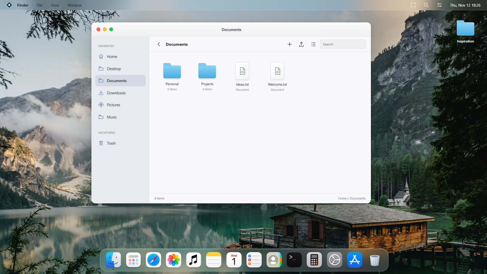
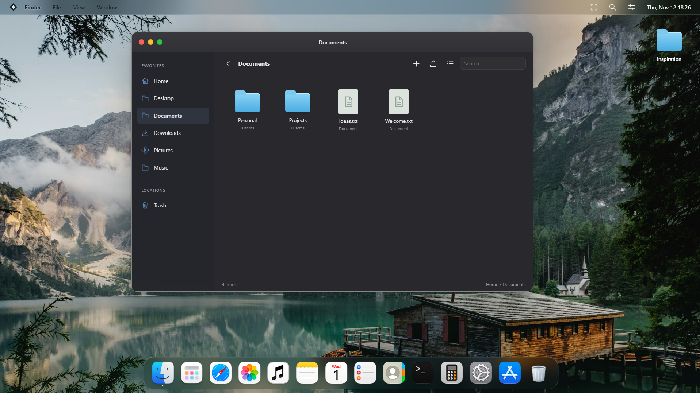

# Atelier



**[Open Atelier](https://atelier.run.place/desktop)** | [Report an issue](https://github.com/victorofsec/Atelier-WEBOS/issues)

Explore without an account. Sign in from **Settings > Account & Storage** for a separate personal cloud workspace. Guest sessions are temporary. A first-run setup offers appearance, wallpapers, accent colors and motion preferences. Cloud access is currently invitation-only on the hosted instance.

### Dark appearance



*Actual desktop screenshots in light and dark appearance.*

A desktop environment in your browser, with movable windows, a magnifying Dock, an independent lock screen, translucent menus and persistent files.

## Run locally

Requires Node.js 22.13 or newer and npm.

```sh
npm ci
npm run build
npm start
```

Open **http://127.0.0.1:5173**. The isolated browser engine runs on port **5174**. Both servers bind only to loopback. The desktop starts without opening any application; the loading screen follows storage, account and application initialization.

## Applications

- File Explorer: folders, imports, drag and drop, selection, renaming and Trash.
- Photos: fitted images, zoom, scrolling and basic edits.
- Music: playback queue, previous/next history and an expanded player inside its window.
- Notes, TextEdit, PDF/Word/PowerPoint previews, Calendar, Reminders and Contacts.
- Terminal, Calculator, Paint, Task Manager and Settings.
- App Store with Code Studio, Git and Archive Utility.
- Real Python through Pyodide; compatible packages install through micropip.
- Git initialization, cloning, staging, commits, branches and HTTPS fetch/pull/push through isomorphic-git.

The music catalog links to preview recordings. Personal full-length audio and account data are not included. Import your own files through File Explorer.

## Workspace controls

Settings has searchable categories for appearance, wallpapers, the Dock, sound, storage and privacy. Drag windows to screen edges or corners to preview a glass tile, then release to snap. Alt + Caps Lock switches windows with animated selection.

Drag apps, files and folders into the Dock, rearrange them, or remove their pins without deleting the originals. Drag a Dock app onto the desktop to create a movable shortcut.

Signed-in workspace lock codes are salted and hashed on the server. Locked sessions cannot read or write cloud snapshots or files; unlock grants a short-lived HttpOnly cookie. Existing plaintext codes migrate automatically. Guest locking is a temporary visual convenience only. This is not end-to-end encryption and does not protect an already unlocked browser from someone controlling that browser.

## Browser

Scramjet renders rewritten pages on a separate origin. The desktop supplies an authenticated HTTP transport; scripts never share the desktop origin. The transport normalizes proxy URLs, compresses transfers, coalesces DNS lookups and caches explicitly reusable static assets. Local HTML documents use a sanitized reader.

This is an experimental browser. Anti-bot checks, certain sign-in flows, DRM and WebSocket-dependent sites may fail. It is not recommended for sensitive accounts. A blocked website is reported explicitly; compatibility is not guaranteed.

## Storage and deployment

The local server persists the local account under `.data/`, excluded from Git. New pending changes stay in memory until the cloud confirms the save. Legacy IndexedDB snapshots are removed after successful synchronization. Keep the page open until pending saves finish. Conflicting edits retain both versions. This local development account is **not a public authentication system**.

The backend functions in `lib/` accept a trusted identity and a bucket-like storage adapter. For a hosted multi-user installation, provide real authentication, overwrite the trusted identity headers server-side, and use durable storage with atomic conditional writes. Keep the browser engine on a separate origin, update both origin constants, and enforce public-only outbound networking for the relay. Do not expose the local development server to the Internet.

## Development

`desktop/` contains application logic. `scripts/build-desktop.mjs` assembles the browser bundle and third-party readers. `public/` contains styles and assets. `browser-engine/` contains the isolated browsing runtime. `server.mjs` provides the local storage and HTTP adapters.

```sh
npm test
```

Tests cover desktop behavior, startup, storage isolation, conflicts, document readers, real Git operations, the browser relay and rewriting engine. DOM tests do not establish visual animation performance.

## Open-source components and assets

The browser engine integration is AGPL-3.0-or-later. Scramjet and BareMux notices and downloadable integration source are included in its build. Exact upstream sources: [Scramjet 57ba89e](https://github.com/MercuryWorkshop/scramjet/tree/57ba89e), [BareMux dc9dc6e](https://github.com/MercuryWorkshop/bare-mux/tree/dc9dc6e).

Other components include PDF.js, docx-preview, Web-PPT, Fabric.js, JSZip, DOMPurify, isomorphic-git, LightningFS and Pyodide. Their notices are generated into `public/OPEN-SOURCE-LICENSES.txt`. Retain `THIRD-PARTY-LICENSE.txt` and the asset notices. Third-party icons, artwork and preview recordings remain subject to their owners' rights; this repository does not grant additional rights to those assets.
